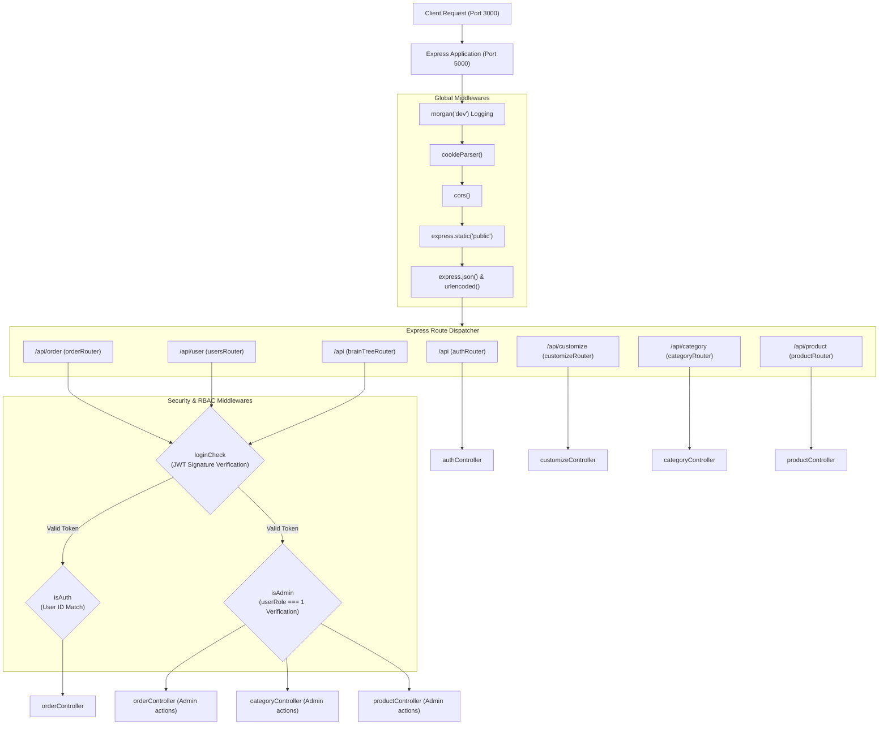
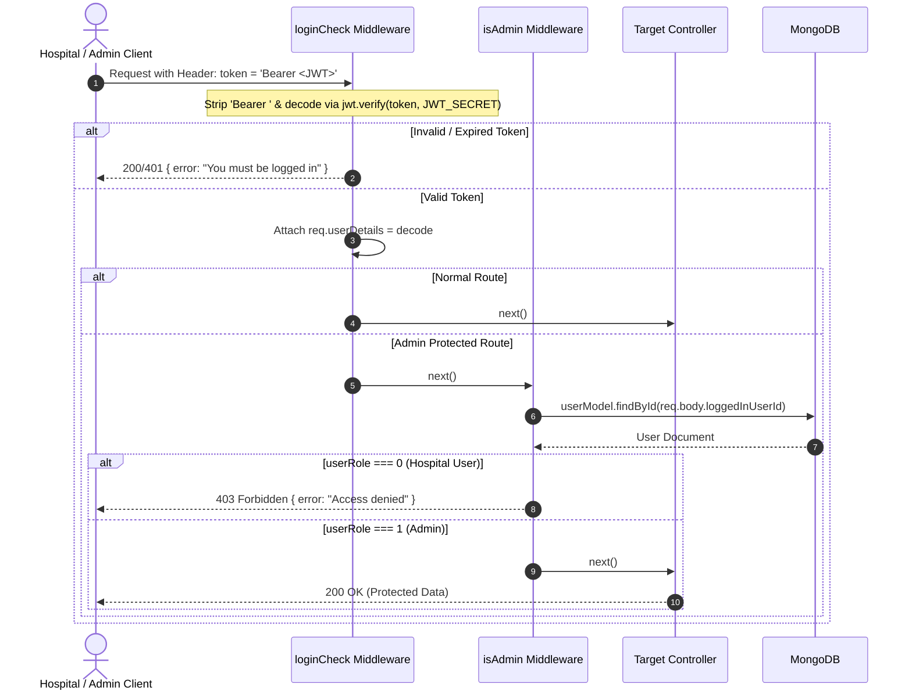

# ⚙️ OrganEase: Backend Architecture & API Workflow

This document provides a comprehensive architectural and workflow breakdown of the **OrganEase** Node.js and Express RESTful backend.

---

## 1. Backend Architecture & Request Flow

---

## 2. Authentication & Role-Based Access Control (RBAC)

The system enforces strict access control across public, hospital user, and procurement officer roles:

---

## 3. Storage & Multer Upload Pipeline

Multer manages image uploads for organ categories, organ inspection photos, and homepage banners:

1. **Upload Folder Auto-Creation**:
   [`uploadFolderCreateScript.js`](file:///D:/PROJECT_S/OrganEase/OrganEase/server/config/uploadFolderCreateScript.js) ensures target directories exist recursively on startup:
   - `./public/uploads/categories`
   - `./public/uploads/products`
   - `./public/uploads/customize`
2. **Multer Storage Strategy**:
   - Files are stamped with timestamps (`Date.now() + "_" + file.originalname`) to prevent filename collisions.
   - Served publicly via Express static middleware: `http://localhost:5000/uploads/...`.
3. **Orphaned File Garbage Collection**:
   - If a database operation fails or a category/product is updated/deleted, the respective controller triggers `fs.unlink()` to remove dead assets from the filesystem.

---

## 4. Comprehensive REST API Reference

### 4.1 Authentication (`/api`)
| Method | Endpoint | Access | Description |
| :--- | :--- | :--- | :--- |
| `POST` | `/api/signup` | Public | Register new hospital / procurement coordinator account. Passwords hashed with `bcryptjs`. |
| `POST` | `/api/signin` | Public | Authenticates credentials; returns signed JWT token and user info with `userRole`. |
| `POST` | `/api/user` | Public | Check if user exists by ID. |

### 4.2 Organ Categories (`/api/category`)
| Method | Endpoint | Access | Description |
| :--- | :--- | :--- | :--- |
| `GET` | `/api/category/all-category` | Public | Retrieve all organ categories sorted by newest first. |
| `POST` | `/api/category/add-category` | Admin | Create new organ category with Multer image upload (`cImage`). |
| `POST` | `/api/category/edit-category` | Admin | Update category details and replace existing image if supplied. |
| `POST` | `/api/category/delete-category` | Admin | Delete category and remove image file from disk. |

### 4.3 Available Organs (`/api/product`)
| Method | Endpoint | Access | Description |
| :--- | :--- | :--- | :--- |
| `GET` | `/api/product/all-product` | Public | Get all preserved organs with populated category details (`cName`). |
| `POST` | `/api/product/product-by-category` | Public | Filter organs by `catId`. |
| `POST` | `/api/product/product-by-price` | Public | Filter organs by PIN code / area token range. |
| `POST` | `/api/product/add-product` | Admin | Post newly procured organ with ischemic hours (`pName`), PIN (`pPrice`), and multi-angle photos. |
| `POST` | `/api/product/edit-product` | Admin | Edit organ record, update cold tolerance parameters. |
| `POST` | `/api/product/delete-product` | Admin | Remove organ record from storage database. |
| `POST` | `/api/product/single-product` | Public | Deep-dive endpoint returning single organ with medical reviews and ratings. |

### 4.4 Requests & Orders (`/api/order`)
| Method | Endpoint | Access | Description |
| :--- | :--- | :--- | :--- |
| `POST` | `/api/order/create-order` | Hospital | Generate new organ transfer request with transactionId, status defaults to `"Under Scrutiny"`. |
| `POST` | `/api/order/order-by-user` | Hospital | Fetch all transfer requests made by the logged-in hospital account. |
| `POST` | `/api/order/get-all-orders` | Admin | Procurement dashboard endpoint to review and manage all organ requests across hospitals. |
| `POST` | `/api/order/update-order` | Admin | State transition trigger: advance request status to `"Request Accepted"`, `"Expired"`, or `"Cancelled"`. |
| `POST` | `/api/order/delete-order` | Admin | Purge order record. |

### 4.5 Braintree Payment Gateway (`/api`)
| Method | Endpoint | Access | Description |
| :--- | :--- | :--- | :--- |
| `GET` | `/api/braintree/get-token` | Hospital | Issues Braintree client token for Drop-In UI initialization. |
| `POST` | `/api/braintree/payment` | Hospital | Processes organ transfer confirmation payment with `paymentMethodNonce`. |

### 4.6 Customization & System Migration (`/api/customize`)
| Method | Endpoint | Access | Description |
| :--- | :--- | :--- | :--- |
| `GET` | `/api/customize/get-slide-image` | Public | Retrieve active hero carousel banners for homepage. |
| `POST` | `/api/customize/upload-slide-image`| Admin | Upload new banner photo to customize collection. |
| `POST` | `/api/customize/dashboard-data` | Admin | Returns aggregate counts for Categories, Organs, Orders, and Users. |
| `GET` | `/api/customize/migrate-db` | Admin/Dev | Triggers the complete database migration and sample data seeding routine. |
