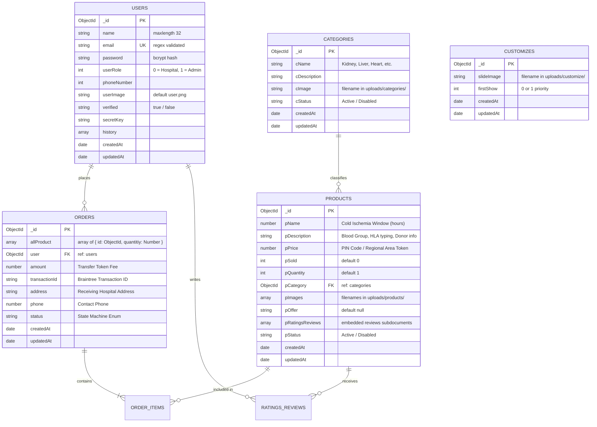
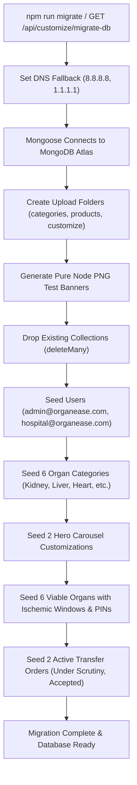

# 🗄️ OrganEase: Database Architecture & Data Workflow

This document provides a comprehensive specification of the **MongoDB** database tier for OrganEase, detailing schemas, relationships, indexing, order state transitions, and migration routines.

---

## 1. Database Entity Relationship (ER) Model



---

## 2. Collections & Schema Specifications

### 2.1 `users` Collection
* **Model File**: [`server/models/users.js`](file:///D:/PROJECT_S/OrganEase/OrganEase/server/models/users.js)
* **Purpose**: Manages authenticated entities (Procurement Officers and Transplant Centers).
* **Validation & Constraints**:
  - `email`: Indexed with `{ unique: true }`, validated via regex `/^([a-zA-Z0-9_\.\-])+\@(([a-zA-Z0-9\-])+\.)+([a-zA-Z0-9]{2,4})+$/`.
  - `password`: Stored as a salted bcrypt hash (`bcrypt.hashSync(password, 10)`).
  - `userRole`: `1` gives access to admin procurement controls, `0` represents hospital requisition teams.

### 2.2 `categories` Collection
* **Model File**: [`server/models/categories.js`](file:///D:/PROJECT_S/OrganEase/OrganEase/server/models/categories.js)
* **Purpose**: Classifies anatomical organs available for transplant.
* **Fields**:
  - `cName`: Unique category name (e.g. `"Kidney"`, `"Liver"`, `"Heart"`, `"Lungs"`, `"Pancreas"`, `"Cornea"`).
  - `cImage`: Stored image filename in `server/public/uploads/categories/`.
  - `cStatus`: `"Active"` or `"Disabled"`.

### 2.3 `products` Collection (Available Organs in Cold Storage)
* **Model File**: [`server/models/products.js`](file:///D:/PROJECT_S/OrganEase/OrganEase/server/models/products.js)
* **Purpose**: Records individual viable organs stored in hypothermic storage units.
* **Domain Adaptations**:
  - `pName` (`Number`): Stores the maximum **ischemic cold tolerance time in hours** (e.g., `24` for Kidney, `6` for Heart, `12` for Liver).
  - `pPrice` (`Number`): Stores the **PIN Code / Postal Area Code** (e.g., `400001`, `110001`) of the donor center for geographic proximity matching.
  - `pCategory`: `Mongoose.Schema.Types.ObjectId` referencing `categories`.
  - `pImages`: Array of image filenames (minimum 2 photos required for organ inspection).
  - `pRatingsReviews`: Embedded array storing pathologist validation comments, donor crossmatch reports, and medical clearance notes.

### 2.4 `orders` Collection (Organ Transfer Requisitions)
* **Model File**: [`server/models/orders.js`](file:///D:/PROJECT_S/OrganEase/OrganEase/server/models/orders.js)
* **Purpose**: Records formal organ transfer requests initiated by hospital transplant teams.
* **State Machine Lifecycle**:
  - `"Not processed"`: Initial request created prior to token settlement.
  - `"Under Scrutiny"`: Default post-confirmation state; procurement officers review surgical team requirements and tissue compatibility.
  - `"Request Accepted"`: Allocation confirmed; transport logistics dispatched.
  - `"Expired"`: Organ exceeded cold ischemia preservation window before transfer completion.
  - `"Cancelled"`: Rejection due to tissue cross-matching incompatibility.

---

## 3. Data Migration & Seeding Lifecycle

To ensure testing and development environments are immediately functional, [`server/config/migrate.js`](file:///D:/PROJECT_S/OrganEase/OrganEase/server/config/migrate.js) automates the seed pipeline:



---

## 4. Windows DNS SRV Resolution Fix for MongoDB Atlas

When running on Windows with Node.js, `mongodb+srv://` URIs often trigger `querySrv ECONNREFUSED` if the host machine's local DNS server does not support recursive SRV records. OrganEase incorporates an automatic runtime fallback in [`server.js`](file:///D:/PROJECT_S/OrganEase/OrganEase/server/server.js) and [`config/migrate.js`](file:///D:/PROJECT_S/OrganEase/OrganEase/server/config/migrate.js):

```javascript
const dns = require("dns");
try {
  dns.setServers(["8.8.8.8", "1.1.1.1"]); // Public Google and Cloudflare DNS
} catch (e) {}
```
This guarantees that Atlas connection strings resolve immediately across all environments without manual operating system network reconfigurations.
