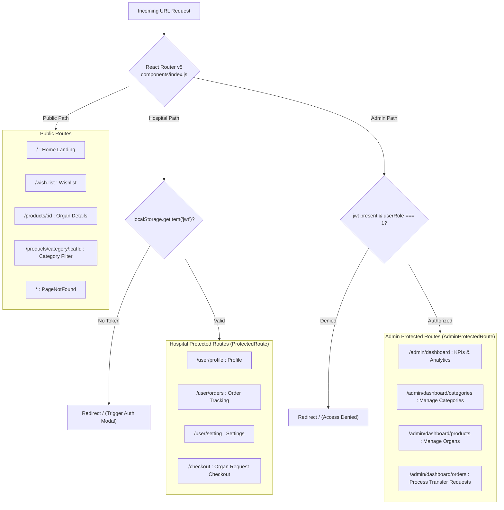

# 💻 OrganEase: Frontend Architecture & Workflow Specification

This document details the frontend implementation, state management patterns, routing lifecycle, and interactive workflows of the **OrganEase** React Single-Page Application (SPA).

---

## 1. Frontend Directory Structure

```
client/src/
├── App.js                         # Root component, LayoutContext Provider
├── index.js                       # ReactDOM entry point
├── components/
│   ├── index.js                   # Main application router (React Router v5)
│   ├── admin/                     # Admin / OPO Management Suite
│   │   ├── categories/            # Category management (Add, Edit, Delete, Table)
│   │   ├── dashboardAdmin/        # Overview KPIs, sales/transfers today, slider customization
│   │   ├── orders/                # Organ request management, status update, filter
│   │   ├── partials/              # AdminNavbar, AdminSidebar, AdminFooter
│   │   └── products/              # Available organs management (Preservation hrs, PIN, Photos)
│   └── shop/                      # Public & Hospital User Portal
│       ├── auth/                  # Login, Signup, ProtectedRoute, AdminProtectedRoute
│       ├── dashboardUser/         # Hospital User Profile, Orders Tracking, Settings
│       ├── home/                  # Landing page (Slider, ProductCategory, SingleProduct)
│       ├── layout/                # Page layout wrapper (Navbar, Footer, CartDrawer)
│       ├── order/                 # Checkout, Braintree payment drop-in, order confirmation
│       ├── partials/              # Navbar, CartModal, Action/Fetch helpers
│       ├── productDetails/        # Single organ deep-dive, multi-angle images, reviews
│       └── wishlist/              # Saved organs wishlist view
```

---

## 2. Routing Architecture & Protected Route Guards



### Route Guard Implementations:
- **`ProtectedRoute.js`**: Checks `localStorage.getItem("jwt")`. If missing, prevents access to patient/hospital specific views (`/user/orders`, `/user/profile`, `/checkout`).
- **`AdminProtectedRoute.js`**: Validates both token existence and checks `JSON.parse(localStorage.getItem("jwt")).user.userRole === 1`. Non-admins are prevented from viewing or modifying procurement databases.

---

## 3. State Management: Dual Context & Reducer Pattern

Instead of bulky external libraries, OrganEase uses a modular **Context + `useReducer`** architecture per feature domain:

```mermaid
flowchart LR
    subgraph ContextDomain["Feature Context Module"]
        State[("Feature State<br/>(initialState)")]
        Dispatch["dispatch(action)"]
        Reducer["featureReducer<br/>(state, action)"]
    end

    subgraph Components["Consuming Components"]
        CompA["Navbar / Trigger"]
        CompB["Data Grid / Cards"]
        CompC["Modal Form"]
    end

    CompA -->|dispatch({ type, payload })| Dispatch
    CompC -->|dispatch({ type, payload })| Dispatch
    Dispatch --> Reducer
    Reducer -->|Computes next state| State
    State -.->|useContext() subscription| CompA
    State -.->|useContext() subscription| CompB
    State -.->|useContext() subscription| CompC
```

### Major Context Providers:
1. **`LayoutContext` (`App.js`)**: Global cart drawer visibility, active modals, and responsive mobile nav toggle.
2. **`HomeContext` (`shop/home/HomeContext.js`)**: Active category filter, text search query, loaded organs array, hero slider image array, and loading spinner state.
3. **`CartContext` (`shop/order/CartContext.js`)**: In-memory organ request basket, donor token fee subtotal, address, phone, and delivery notes.
4. **`ProductContext` (`admin/products/ProductContext.js`)**: Admin add/edit modal states, product table data, and form field bindings.
5. **`OrderContext` (`admin/orders/OrderContext.js`)**: Procurement officer order filtering, search by transaction ID, and status change actions.

---

## 4. Key Interactive Workflows

### 4.1 Cold Ischemia Viability & Expiration Monitoring
In organ transplantation, preservation time in static hypothermic storage is crucial.
* The frontend component [`ProductTable.js`](file:///D:/PROJECT_S/OrganEase/OrganEase/client/src/components/admin/products/ProductTable.js) and [`SingleProduct.js`](file:///D:/PROJECT_S/OrganEase/OrganEase/client/src/components/shop/home/SingleProduct.js) monitor viability in real-time:
```javascript
const createdAt = new Date(product.createdAt);
const expirationDate = moment(createdAt).add(product.pName, 'hours');
const currentTime = moment();

if (expirationDate.isBefore(currentTime)) {
  product.pStatus = "Disabled"; // Organ has exceeded cold ischemia tolerance
} else {
  const remainingHours = expirationDate.diff(currentTime, 'hours');
  // Displays active countdown to surgical teams
}
```

### 4.2 Braintree Payment Drop-In & Token Confirmation
1. User clicks **"Proceed to Request"** on [`CheckoutProducts.js`](file:///D:/PROJECT_S/OrganEase/OrganEase/client/src/components/shop/order/CheckoutProducts.js).
2. Client queries `GET /api/braintree/get-token` using the authenticated JWT.
3. The returned `clientToken` initializes `<DropIn options={{ authorization: clientToken }} />`.
4. Hospital team enters verification card details; Braintree SDK tokenizes the payment instrument and emits a `paymentMethodNonce`.
5. Client issues `POST /api/braintree/payment` with the nonce and organ transfer token fee.
6. Upon HTTP 200 receipt, the cart is cleared from `localStorage` and the order status is displayed as `"Under Scrutiny"`.
