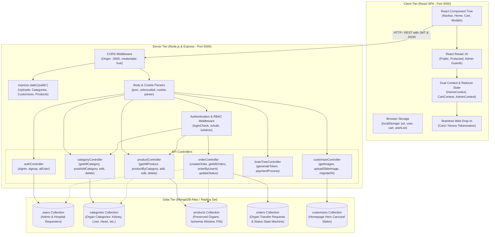
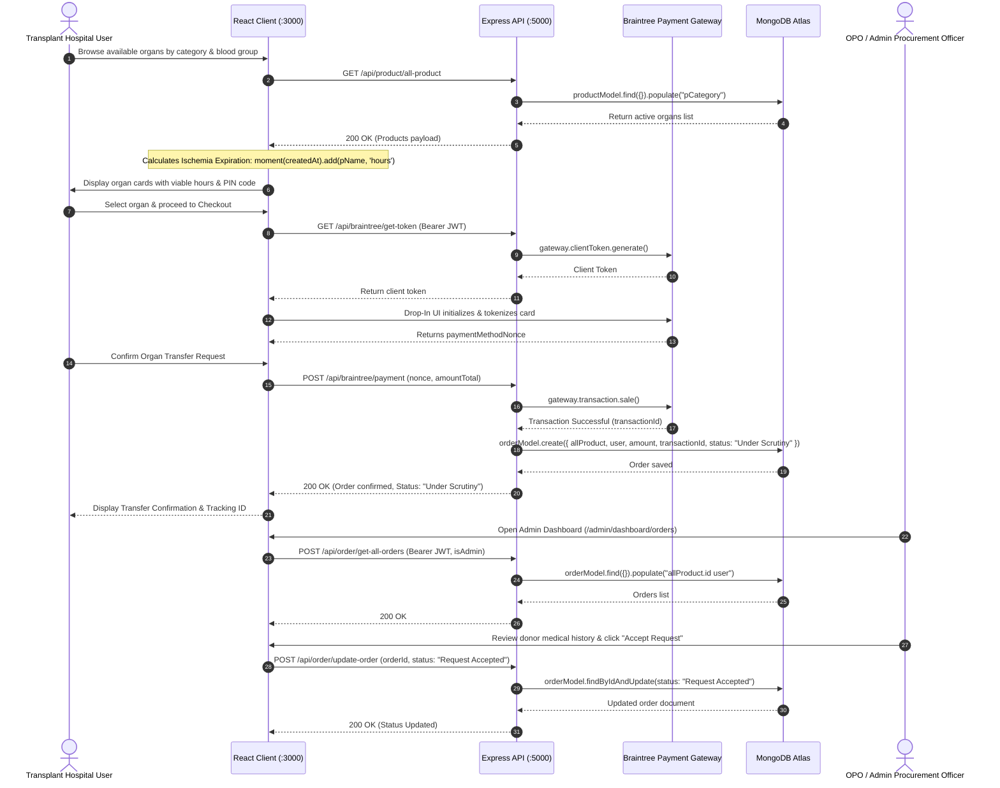
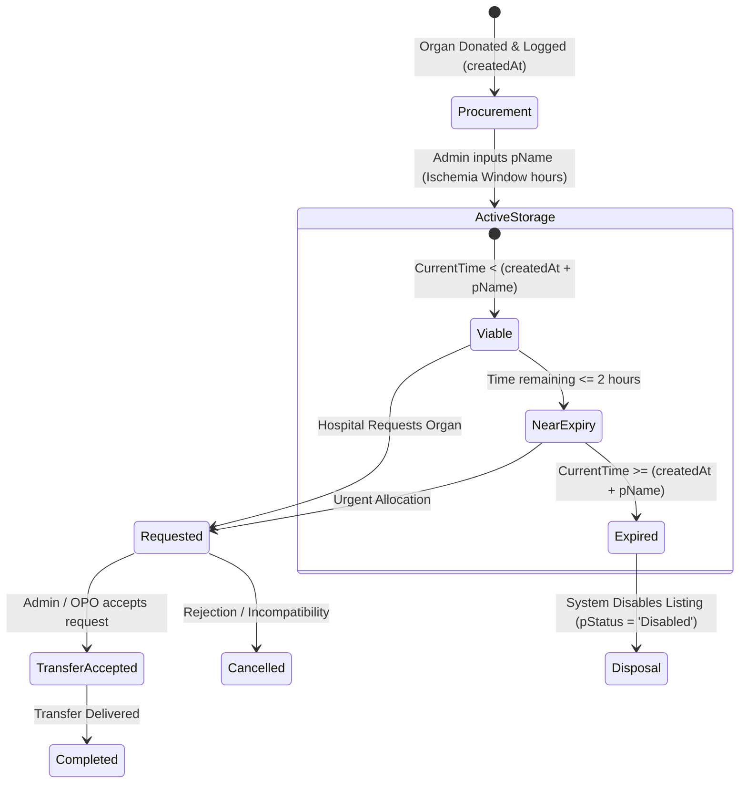

# 🏥 OrganEase: System Architecture & End-to-End Workflow

This document provides a production-grade architectural and technical workflow specification for **OrganEase**, an automated digital platform bridging Organ Procurement Organizations (OPOs), hypothermic organ storage centers, and transplant hospitals.

---

## 1. High-Level Multi-Tier Architecture

---

## 2. End-to-End Organ Request & Allocation Workflow

---

## 3. Tier Responsibilities & Component Mapping

| Architectural Tier | Core Technologies | Primary Responsibilities | Key Files / Modules |
| :--- | :--- | :--- | :--- |
| **Client Tier** | React 16.13, React Router v5, Tailwind CSS, Axios, Moment.js, Braintree Drop-In | • User authentication state and JWT storage in `localStorage` • Real-time organ search, category filtering & pagination • Dynamic cold ischemia expiration calculation via Moment.js • Secure tokenized payment modal for transfer confirmation tokens • Separate User and Admin protected dashboard suites | [`App.js`](file:///D:/PROJECT_S/OrganEase/OrganEase/client/src/App.js) [`HomeContext.js`](file:///D:/PROJECT_S/OrganEase/OrganEase/client/src/components/shop/home/HomeContext.js) [`SingleProduct.js`](file:///D:/PROJECT_S/OrganEase/OrganEase/client/src/components/shop/home/SingleProduct.js) [`CheckoutProducts.js`](file:///D:/PROJECT_S/OrganEase/OrganEase/client/src/components/shop/order/CheckoutProducts.js) |
| **Server Tier** | Node.js 20+, Express 4.18, JWT, bcryptjs, Braintree SDK, Multer | • Centralized REST API endpoints • Role-Based Access Control (RBAC): `userRole: 0` (Hospital) vs `1` (Admin) • Multer file uploads for organ and category imagery • Braintree gateway integration for transaction validation • Upload directory auto-generation & DNS fallback for Atlas | [`server.js`](file:///D:/PROJECT_S/OrganEase/OrganEase/server/server.js) [`middleware/auth.js`](file:///D:/PROJECT_S/OrganEase/OrganEase/server/middleware/auth.js) [`controller/products.js`](file:///D:/PROJECT_S/OrganEase/OrganEase/server/controller/products.js) [`controller/orders.js`](file:///D:/PROJECT_S/OrganEase/OrganEase/server/controller/orders.js) [`controller/braintree.js`](file:///D:/PROJECT_S/OrganEase/OrganEase/server/controller/braintree.js) |
| **Data Tier** | MongoDB Atlas, Mongoose 5.9, Replica Set Cluster | • Schema validation, indexing, and referential data integrity • Population queries (`allProduct.id`, `pCategory`, `user`) • Order status state machine lifecycle • Idempotent database migrations and seeding routines | [`models/users.js`](file:///D:/PROJECT_S/OrganEase/OrganEase/server/models/users.js) [`models/categories.js`](file:///D:/PROJECT_S/OrganEase/OrganEase/server/models/categories.js) [`models/products.js`](file:///D:/PROJECT_S/OrganEase/OrganEase/server/models/products.js) [`models/orders.js`](file:///D:/PROJECT_S/OrganEase/OrganEase/server/models/orders.js) [`config/migrate.js`](file:///D:/PROJECT_S/OrganEase/OrganEase/server/config/migrate.js) |

---

## 4. Cold Ischemia Expiration & Viability State Machine

Organs in hypothermic preservation have strict time thresholds. OrganEase models this dynamically across the stack:

