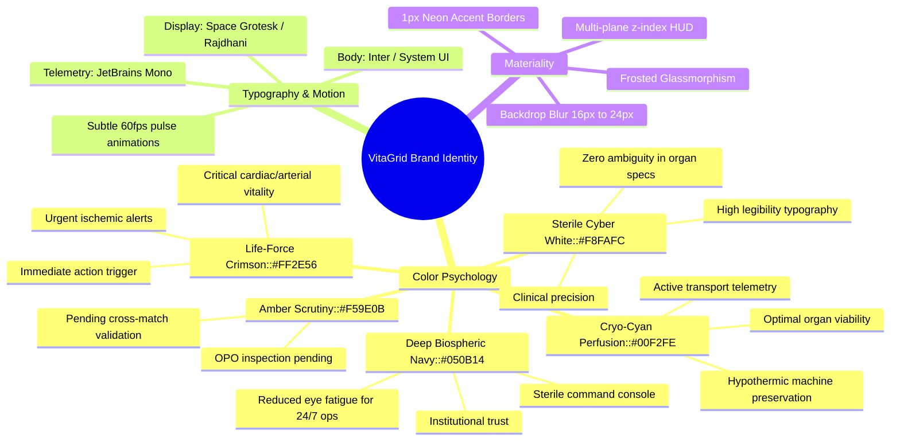
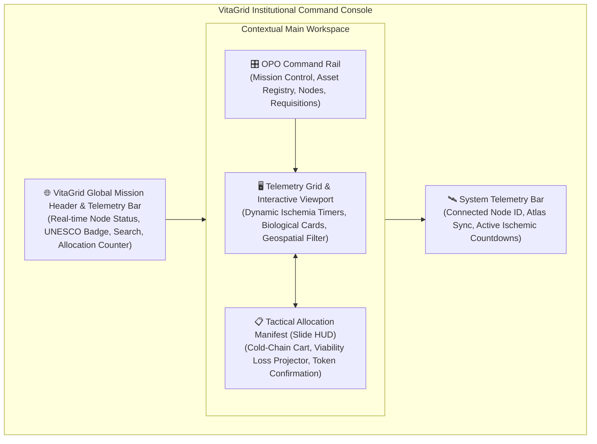
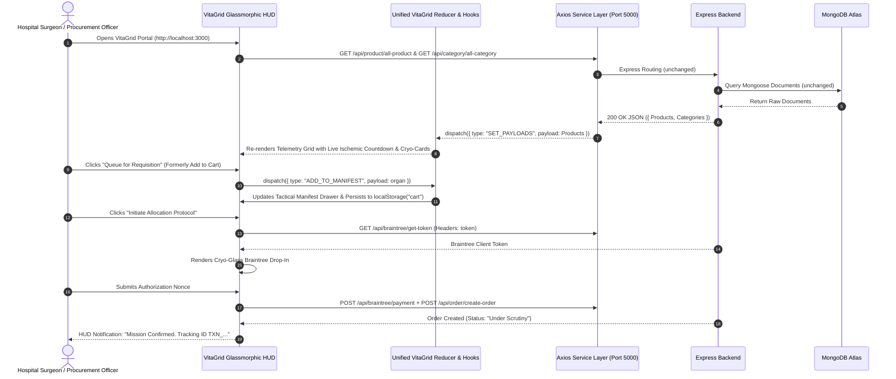
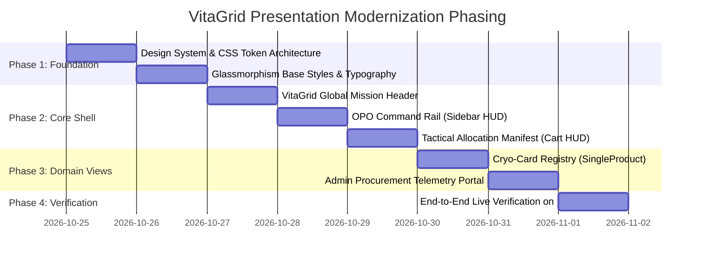

# 🌐 VitaGrid: A UNESCO Humanitarian Logistics Network
## Frontend Presentation Tier Modernization & HUD Architecture Blueprint

---

## 1. Executive Summary & Architectural Mandate

This document serves as the master architectural specification for replacing the legacy frontend presentation tier of the **OrganEase** platform. The modernized presentation tier is rebranded as **VitaGrid: A UNESCO Humanitarian Logistics Network**.

### The Immutable Boundary
* **Backend Tier**: Node.js & Express RESTful services running on **Port 5000** remain 100% unaltered.
* **Database Tier**: MongoDB Atlas cluster with Mongoose ODM remains 100% unaltered.
* **API Contracts**: All schemas (`pName` as ischemic cold preservation hours, `pPrice` as postal routing PIN / logistics token, `status` enum transitions, Braintree payment nonces, JWT token headers) remain strictly preserved.

---

## 2. Legacy Presentation Stack Audit & Modernization Vector

### 2.1 Current Frontend Stack Analysis

| Layer | Existing Implementation | Architectural Limitations | Modernization Vector for VitaGrid |
| :--- | :--- | :--- | :--- |
| **Framework & Engine** | React 16.13.1 (CRA / Webpack 4) | Legacy React lifecycle patterns; strict Node 17+ OpenSSL crypto incompatibilities requiring `--openssl-legacy-provider`. | Maintain React compatibility while decoupling UI into modern functional components, hooks, and clean compositional boundaries. |
| **Routing** | React Router v5.2.0 | Flat routing table in [`components/index.js`](file:///D:/PROJECT_S/OrganEase/OrganEase/client/src/components/index.js); rigid separation between user shop and admin layouts. | Unified Workspace Shell with contextual HUD routing; preserve history push/replace semantics while embedding deep view state. |
| **Styling & Presentation** | Legacy Tailwind CSS 1.x static bundle ([`client/public/style.css`](file:///D:/PROJECT_S/OrganEase/OrganEase/client/public/style.css)) + scattered CSS files | Monolithic 1.9MB static CSS; high reliance on e-commerce style primitives (brown/yellow accents, white cards, standard drop shadows). | Cyber-humanitarian design tokens, backdrop filters, CSS custom properties, responsive glassmorphic cards, and high-frequency telemetry counters. |
| **State Management** | Context API + `useReducer` | Dual context pattern per domain (`HomeContext`, `LayoutContext`, `CartContext`, etc.) spread across disjoint files. | Consolidate and preserve the Context + `useReducer` paradigm; expose domain actions through streamlined hooks (`useVitaGrid`, `useManifest`, `useTelemetry`). |
| **Domain Semantics** | Generic Commercial E-Commerce | "Shopping Cart", "Add to Cart", "Product Table", "Today Sell", "PIN Code: Price". | Institutional, humanitarian lexicon: "Cold-Chain Asset Registry", "Tactical Allocation Manifest", "Ischemia Window Countdown", "Geospatial Routing Node". |

---

## 3. Brand Identity & Color Psychology: VitaGrid

The user experience transitions from a generic commercial storefront to an authoritative, mission-critical international command console under UNESCO humanitarian oversight.



### 3.1 Design Tokens & CSS Palette

```css
:root {
  /* Biospheric Backgrounds (Void to Deep Navy) */
  --vg-bg-void: #030712;
  --vg-bg-surface-dark: #070D1E;
  --vg-bg-surface-elevated: #0B1736;
  --vg-bg-surface-glass: rgba(11, 23, 54, 0.72);
  --vg-bg-card-glass: rgba(16, 32, 70, 0.55);

  /* Sterile Clinical Whites & Grays */
  --vg-text-primary: #F8FAFC;
  --vg-text-secondary: #94A3B8;
  --vg-text-muted: #64748B;
  --vg-border-subtle: rgba(255, 255, 255, 0.08);
  --vg-border-luminous: rgba(0, 242, 254, 0.25);

  /* Life-Critical Status Accents */
  --vg-crimson-pulse: #FF2E56;
  --vg-crimson-glow: rgba(255, 46, 86, 0.35);
  --vg-cryo-cyan: #00F2FE;
  --vg-cryo-glow: rgba(0, 242, 254, 0.30);
  --vg-emerald-viable: #10B981;
  --vg-amber-scrutiny: #F59E0B;
  --vg-amber-glow: rgba(245, 158, 11, 0.30);

  /* HUD Surfaces */
  --vg-backdrop-blur: blur(18px);
  --vg-hud-shadow: 0 8px 32px 0 rgba(0, 0, 0, 0.45);
}
```

---

## 4. Glassmorphic HUD Workspace Architecture

The legacy presentation tier had three fragmented layout anchors:
1. `Navbar`: Generic white horizontal header.
2. `AdminSidebar`: Static grey box with standard icons.
3. `CartModal`: E-commerce shopping bag modal.

These will be replaced with an integrated **Glassmorphic Command Console**:



### 4.1 Component 1: VitaGrid Global Mission Header
* **Replaces**: [`components/shop/partials/Navber.js`](file:///D:/PROJECT_S/OrganEase/OrganEase/client/src/components/shop/partials/Navber.js) & [`components/admin/partials/AdminNavber.js`](file:///D:/PROJECT_S/OrganEase/OrganEase/client/src/components/admin/partials/AdminNavber.js)
* **Visual Form**: Persistent floating glass banner (`top-0`, full width, frosted acrylic backdrop, thin cyan neon under-border).
* **Capabilities**:
  * **Institutional Branding**: UNESCO Humanitarian Logistics Network emblem & VitaGrid pulse indicator.
  * **Global Telemetry Ticker**: Real-time counter of viable organs currently preserved in hypothermic storage.
  * **Unified Omni-Search**: Fast multi-parameter search (Organ organ type, ABO blood group, maximum ischemia hours, donor location PIN).
  * **Tactical Requisition Indicator**: Replacing the "Cart Icon" with an active payload badge that highlights the total viable payloads queued for transfer.
  * **Identity / Node Switcher**: Quick-action authenticated badge displaying logged-in hospital credential, procurement role badge (`ROLE: PROCUREMENT_ADMIN` vs `ROLE: TRANSPLANT_HOSPITAL`), and secure logout.

### 4.2 Component 2: OPO Command Rail (Sidebar HUD)
* **Replaces**: [`components/admin/partials/AdminSidebar.js`](file:///D:/PROJECT_S/OrganEase/OrganEase/client/src/components/admin/partials/AdminSidebar.js)
* **Visual Form**: Left-anchored vertical HUD rail with collapsible micro-dock mode, glowing active indicators, and translucent glass backdrop.
* **Capabilities**:
  * **Contextual Navigation**: Adapts automatically based on role:
    * *Hospital Role*: Global Registry, My Active Requisitions, Organ Matching Portal, Profile & Node Settings.
    * *Procurement Officer (Admin) Role*: Command Hub, Add Biological Payload, Manage Organ Categories, Transfer Authorizations, Hero Banner Customization.
  * **Live Urgency Meters**: Visual indicator tracking organs that have < 4 hours of ischemic preservation window remaining.

### 4.3 Component 3: Tactical Allocation Manifest (Cryo-Cart HUD)
* **Replaces**: [`components/shop/partials/CartModal.js`](file:///D:/PROJECT_S/OrganEase/OrganEase/client/src/components/shop/partials/CartModal.js)
* **Visual Form**: Sleek slide-over glass drawer (`right-0`, `h-full`) styled with micro-mesh dark glass and arterial crimson accent borders.
* **Capabilities**:
  * **Viability Preservation Countdown**: Displays each selected organ with a dynamic countdown clock:
    $$\text{Viability Remaining} = (\text{createdAt} + pName \times 3600\,\text{s}) - \text{currentTime}$$
  * **Geospatial Proximity Match**: Displays donor center PIN (`pPrice`) alongside recipient hospital address.
  * **Seamless Braintree Integration**: Launches the encrypted Braintree Sandbox Drop-In directly within the manifest console, triggering confirmation without leaving the operational workspace.

---

## 5. End-to-End Presentation Tier Data Flow & API Compatibility



---

## 6. Implementation Phasing Strategy



### Verification Criteria:
1. **0% Backend Code Changes**: Backend remains on port 5000 with unchanged endpoints.
2. **0% Database Schema Changes**: MongoDB Atlas continues storing existing structures seamlessly.
3. **100% Behavioral Parity**: All capabilities (Auth, Admin protection, Organ CRUD, Order state machine, Braintree payments, Image uploads) function with complete reliability under the new futuristic presentation tier.
